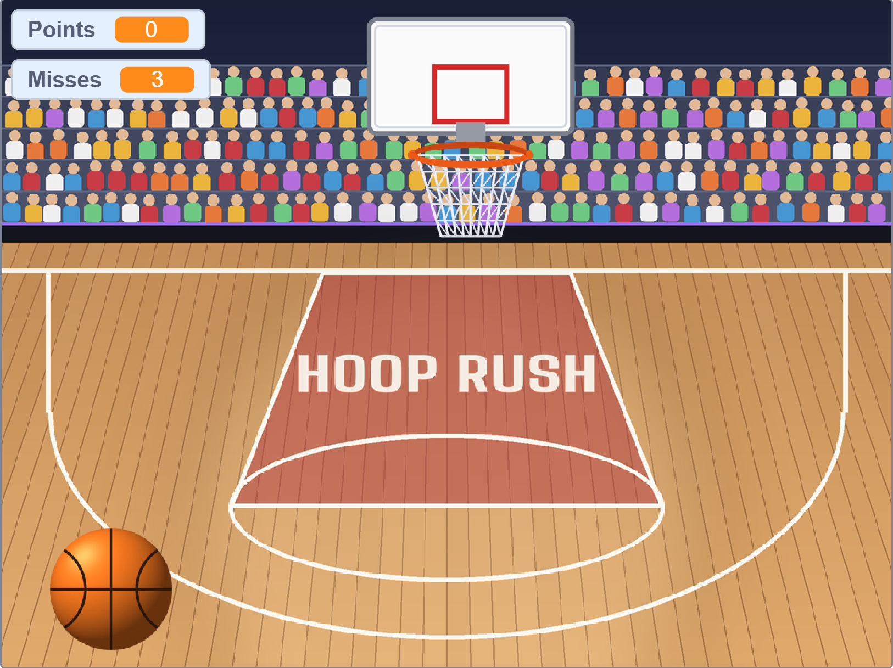

# Hoop Rush

A basketball arcade mini-game made in Scratch for CS50x (Problem Set 0).
Score 21 baskets before you miss three shots. The hoop moves faster with every basket.

> **Status:** Final (v2, with music and sound effects) · submitted and approved by CS50 · no further updates planned
> **Author:** Jose Manuel Lozano Barba ([GitHub](https://github.com/jm-lozano-pm))

---

## 1. Game Design Document (GDD)

### 1.1 Concept
| | |
|---|---|
| **Genre** | Arcade / skill shooter |
| **Platform** | Scratch (browser) |
| **Players** | 1 |
| **Session length** | 1–3 minutes |
| **Pillars** | Simple to learn · escalating tension · "one more try" |

### 1.2 Core loop
1. Move the ball sideways to line it up with the hoop.
2. Shoot. A basket scores a point and makes the hoop faster.
3. A miss costs one of three lives.
4. Reach 21 points to win, or lose all lives to get Game Over.

### 1.3 Rules
- You start with **0 points** and **3 lives** (misses left).
- Each basket gives **+1 point**. Each miss costs **1 life**.
- **Win:** reach **21 points**.
- **Lose:** reach **0 lives**.
- The hoop moves back and forth across the court at a fixed height and bounces off the screen edges.

### 1.4 Controls
- **Move the mouse** left and right: the ball follows your cursor horizontally while you aim.
- **Click** to shoot: the ball rises toward the hoop.
- The shot is a basket if the ball touches the hoop at that moment; otherwise it counts as a miss.
- Only the mouse is used.

### 1.5 Difficulty and progression
Difficulty scales with a single lever: the hoop's speed. It starts at 5 and grows by 1 for every point, so the first baskets are easy and the last few are tense. The player's skill and timing decide how far they get.

### 1.6 Screens
| Screen | Purpose |
|---|---|
| Court (gameplay) | Half court with stands; ball and hoop are separate sprites. "HOOP RUSH" is painted on the key as the title. |
| Game Over | Darkened, red-tinted arena with a "GAME OVER" banner. |
| Victory | Bright arena with spotlights, confetti and a gold "YOU WIN!" banner. |

### 1.7 Audio
| Sound | When it plays |
|---|---|
| Gameplay music (loop) | During the game, repeating until it ends |
| Basket sound | When a shot goes in (net swish) |
| Miss sound | When a shot misses (rim clang and "bonk") |
| Victory music | On the Victory screen |
| Defeat music | On the Game Over screen |

### 1.8 Art and audio assets
All assets are original and were generated as images and sound files (not taken from any external source):
- `ball.png`, `hoop.png`
- `court_background_title.png`, `game_over_background.png`, `victory_background.png`
- `gameplay_music_loop.wav`, `victory_music.wav`, `defeat_music.wav`, `basket_sound.wav`, `miss_sound.wav`

Style: arcade look with wood and orange tones on the court, dark navy and purple accents in the arena, red for defeat and gold for victory. Audio is retro, chiptune-inspired.

---

## 2. Product Requirements (PRD-lite)

### 2.1 Goal
Deliver a playable, polished mini-game that meets the CS50x Scratch problem set and works as a small portfolio piece.

### 2.2 Target player
Casual players who want a quick, replayable challenge.

### 2.3 Scope by version
| Feature | v1 | v2 (final) |
|---|---|---|
| Ball and hoop sprites with original art | Done | Done |
| Mouse aiming and click-to-shoot | Done | Done |
| Moving hoop that speeds up with each point | Done | Done |
| Points and lives tracking | Done | Done |
| Win condition (21 points) and Victory screen | Done | Done |
| Lose condition (3 misses) and Game Over screen | Done | Done |
| Music and sound effects | — | Done |

### 2.4 Result
- Reviewed and **approved** in CS50x Problem Set 0.
- Not every requirement was met: the project does not include a custom block with an input. Approval needs at least 70% of the requirements, and this was the one missed.

### 2.5 Versions
| Version | Content |
|---|---|
| v1 | Playable game: art, mouse controls, win and lose screens |
| v2 (final, submitted) | v1 plus gameplay music, victory and defeat music, and basket and miss sound effects |

The game is considered finished at v2 and will not be updated further.

### 2.6 Lessons learned
- Scoping the game around one difficulty lever (hoop speed) kept the design simple and the balance easy to tune.
- Adding the win condition late showed that a game with no way to win feels unfinished, so a clear end goal belongs in the first design.
- Audio and end screens add a lot of polish for little work.
- I want to practise custom blocks (reusable code with inputs) in the next project.

---

## 3. Credits and academic honesty
- Game design, code and logic: Jose Manuel Lozano Barba.
- Art and audio assets: generated with Claude (Anthropic) as original files.
- No AI wrote, reviewed or debugged the Scratch code while the project was being built or submitted, in line with CS50's academic honesty policy. Once the project was approved, Claude read it only to document what the game does.

## 4. Repository contents
- `README.md` — this document (GDD + PRD)
- `assets/images/` — screenshot, sprites and backdrops
- `assets/audio/` — music and sound effects

The Scratch project file is not published here.
